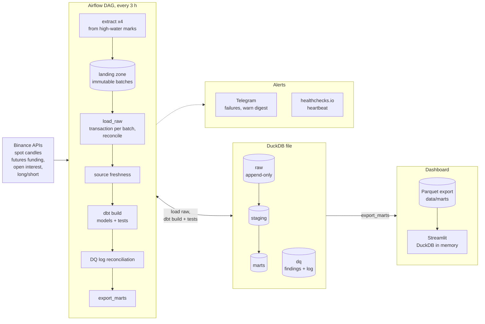

# crypto-market-dwh-duckdb

A local, free market-data pipeline for Binance: Binance API → landing zone → DuckDB → dbt →
Parquet → Streamlit, orchestrated by Airflow, with a data quality layer that checks the
data, the loads and itself, and alerts in Telegram. It is the base of a personal
trading-signal system (features, labels and honest backtests come next).

> **Status: live.** Since 2026-11-27 this pipeline owns the landing zone and runs every
> 3 hours at :07 UTC. It is the DuckDB port of
> [crypto-market-dwh](https://github.com/avbakanin/crypto-market-dwh) (Snowflake, archived
> when its trial ended). The port was checked layer by layer against a baseline taken in
> Snowflake on the same input: [docs/duckdb_vs_snowflake.md](docs/duckdb_vs_snowflake.md).

**First question answered: what happens to volume, open interest and funding in the 24 hours
around a sharp hourly rise of a coin?** On a year of hourly data for 23 liquid coins.

- **Findings:** [docs/findings.md](docs/findings.md): five conclusions with sample sizes and
  confidence intervals.
- **Data quality:** [docs/data_quality_report.md](docs/data_quality_report.md): 164 data
  tests, 13 unit tests, what they found in real APIs.
- **Source notes:** [docs/source_notes.md](docs/source_notes.md): observations about the
  Binance APIs, Snowflake, DuckDB, dbt, Airflow and Docker, each with evidence.
- **Port check:** [docs/duckdb_vs_snowflake.md](docs/duckdb_vs_snowflake.md) and
  [docs/duckdb_vs_snowflake_export.md](docs/duckdb_vs_snowflake_export.md): every layer and
  the exported marts against the Snowflake baseline
  ([docs/snowflake_baseline.md](docs/snowflake_baseline.md)).

## Architecture



- **Extract** works from high-water marks kept in the landing zone, not from the warehouse:
  each run fetches only what is new, writes an immutable batch and its manifest last.
- **The landing zone is the source of truth;** the DuckDB file is a cache that can be rebuilt
  from it at any time (`python -m ingestion.load_raw`, then `dbt build`).
- **Load** puts each batch into a RAW journal that keeps every version of a record with its
  lineage, in one transaction per batch: guard on `_batch_id`, insert, reconcile rows and
  duplicates per symbol against the manifest, then commit or roll back.
- **dbt** types, deduplicates and tests in staging, builds hourly market state and the
  pump marts, stores the findings of every test in the `dq` schema and logs every node of
  every run.
- **The dashboard** reads the Parquet export, never the warehouse file (DuckDB has one writer).

## Stack

| Layer | Tools |
|---|---|
| Ingestion | Python 3.12, `requests`, `pyarrow` |
| Warehouse | DuckDB 2.0.1, one local file |
| Transformation and tests | dbt Core 1.12.7, dbt-duckdb 1.11.1, dbt_utils |
| Orchestration and alerts | Airflow 3.4.0 (LocalExecutor) in Docker Compose, Telegram bot, healthchecks.io |
| Dashboard | Streamlit 1.67, DuckDB 2.0, Altair |
| Quality of the code | pytest (435 tests + 67 DAG and alert tests), dbt unit tests, mutation testing, ruff, pyright |

## Findings in one screen

From 198 pumps (an hour ≥ 5 % above the previous close; +20 % happened once in a year among
liquid coins) on 23 coins, 2025-11-21 … 2026-11-23, each compared with 30 ordinary hours of
the same coin. Details and limits: [docs/findings.md](docs/findings.md).

1. **A third of pumps are market moves:** 78 of 198 happened on 21 days when several coins
   rose in the same hour; 120 were a single coin's own.
2. **Volume leaves a footprint about three hours before:** 1.56× the weekly mean in the hour
   before the pump, against 0.70× in ordinary hours (excess +0.84, 95 % CI +0.50 … +1.23).
3. **No follow-through after the pump hour closes:** +24 h median excess +0.20 %, CI −2.15 % …
   +2.09 %. The move is the hour itself.
4. **As a predictor the footprint is weak:** an hour with volume ≥ 2× its weekly mean is
   followed by a pump in 0.58 % of cases, 4.5× the base rate, yet more than 99 % false alarms.
5. **Funding shows no short squeeze;** top traders leaning short before a rally is a
   hypothesis on six days of long/short history, to check as it accumulates.

## Data quality in one screen

Full report: [docs/data_quality_report.md](docs/data_quality_report.md).

- **Stop vs warn:** 151 stop tests for what breaks a model (keys, NULLs, OHLC, ratios that do
  not match their shares); 13 warn tests for properties of the source (missing hours,
  skipped funding settlements, revised history, spot vs futures price, anomalous volume).
- **Found in real APIs:** a funding settlement Binance skipped for 20 of 21 contracts, open
  interest that pages backwards and disappears after 30 days, long/short shares rounded so
  that a fixed tolerance raises 963 false alarms, a contract quoted per 1 000 coins.
- **The checks are checked:** findings live in the `DQ` schema, every run is logged by a
  dbt hook, a reconciliation test proves the log matches the findings tables, and every test
  was broken on purpose (mutation testing) before it was trusted.
- **Shown live:** a resent candle with `high` and `low` swapped stopped the DAG at the stop
  test and sent one Telegram message pointing at the offending row.

## Screenshots

Taken on the Snowflake original; the port's dashboard, DAG and alerts are the same.

**Dashboard, pumps.** 198 episodes over a year, split into single-coin pumps and market
moves; filters by scope, coin, date and threshold.


**One event, hour by hour:** price against the start and volume against its weekly mean,
from 24 hours before the pump to 24 hours after.


**Dashboard, profile ±24 h:** the median pump against the median ordinary hour of the same
coins, here price against the start; the band is the middle half of the pumps. Other
metrics: volume, taker buy share, funding, open interest, long/short.


**Dashboard, data quality:** the newest dbt build, and how far each dataset reaches.


**Airflow:** the last ten runs, every task green; a pink square is an extract with nothing
new (exit code 99 → skipped: funding settles every 4 or 8 hours).


**Telegram alert** from the week 4 demonstration: the failed stop test, the row count and
the query that shows the offending row, plus the warnings that ran before the stop.


## Run it

**Prerequisites.** Docker Desktop. No accounts and no keys: the warehouse is a local file.

1. Copy [.env.example](.env.example) to `.env` and fill it in (it says what each value is).
2. From the repo root:

```powershell
docker compose --profile tools --profile dashboard build
docker compose up -d
docker compose --profile dashboard up -d dashboard
```

Then in the Airflow UI at http://127.0.0.1:8090 unpause `crypto_pipeline` and trigger it
once: on an empty landing zone the extracts fetch a year of candles and funding and 30 days
of open interest and long/short, then the run loads, builds, tests and exports. The
dashboard at http://127.0.0.1:8502 shows the data. The DAG then runs every 3 hours at :07 UTC.

Run manual commands (`docker compose run --rm project ...`) only between DAG runs: DuckDB
allows one writer.

**Without Docker**, from an existing export in `data/marts/`:

```powershell
pip install -r requirements-dashboard.txt
python -m analysis.pump_findings
```

## Checks

```powershell
pip install -r requirements-dev.txt
ruff check .; ruff format --check .; pyright; python -m pytest -q
docker build --target test -t crypto-market-dwh-duckdb:test .; docker run --rm crypto-market-dwh-duckdb:test
docker run --rm --entrypoint python crypto-market-dwh-duckdb:test -m pytest -q tests_airflow
```

The test image runs the same suite on Linux; the last command runs the DAG and alert tests
with Airflow's own interpreter.

- **Against Snowflake:** `python -m analysis.compare_baseline` (every layer on the baseline's
  input) and `python -m analysis.compare_export` (the marts row by row against an export of
  the original on the same input).
- **Determinism:** two full `dbt build` runs on the same RAW give equal fingerprints (row
  count and row hashes) for every table except the two append-only DQ journals
  (`dq.dbt_node_results`, `dq.dq_check_results`), which gain one build's rows (source
  note 127).

## Repository

| Path | What |
|---|---|
| [ingestion/](ingestion/) | Binance clients, extracts, landing zone batches, loader, export, environment check |
| [dbt/](dbt/) | models (staging, intermediate, marts, DQ), tests, macros, DQ log hooks |
| [dags/](dags/) | the pipeline DAG and the alerting package |
| [dashboard/](dashboard/) | Streamlit app and its data layer |
| [research/](research/) | signal research: walk-forward protocol, placebo, guarded holdout ([docs/signal_research.md](docs/signal_research.md)) |
| [signals/](signals/) | forward test: registered versions, frozen models, chained signal log, Telegram ([docs/forward_test.md](docs/forward_test.md)) |
| [analysis/](analysis/) | the findings report; comparisons with the Snowflake baseline and export; landing zone fingerprint |
| [tests/](tests/), [tests_airflow/](tests_airflow/) | Python tests; DAG and alert tests |
| [docs/](docs/) | findings, data quality report, source notes, Snowflake baseline and the port's comparisons |

## Footprint

A run takes about 75 seconds including the extracts. The warehouse file is about 190 MB and
levels off: dbt recreates every table, and DuckDB reuses the freed blocks (source note 126).
