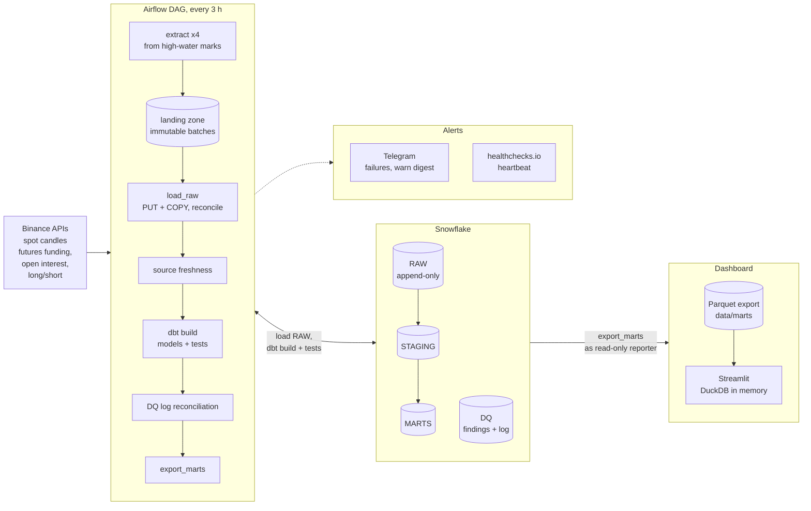

# crypto-market-dwh-duckdb

> **Port in progress.** This repository is the DuckDB port of
> [crypto-market-dwh](https://github.com/avbakanin/crypto-market-dwh), the same pipeline
> on Snowflake, whose 30-day trial ends in December 2026. The port keeps the landing zone,
> the dbt models and the data quality layer, replaces Snowflake with one local DuckDB file
> (dbt-duckdb), and is checked layer by layer against a baseline taken in Snowflake on the
> same input ([docs/snowflake_baseline.md](docs/snowflake_baseline.md)). Until the port is
> finished, the text below describes the Snowflake original.

**What happens to volume, open interest and funding in the 24 hours around a sharp hourly
rise of a coin?** An end-to-end pipeline answers it on a year of Binance data: Binance API →
Snowflake → dbt → Streamlit, orchestrated by Airflow, with a data quality layer that checks
the data, the loads and itself.

- **Findings:** [docs/findings.md](docs/findings.md): five conclusions with sample sizes and
  confidence intervals.
- **Data quality:** [docs/data_quality_report.md](docs/data_quality_report.md): 164 data
  tests, 13 unit tests, what they found in real APIs.
- **Source notes:** [docs/source_notes.md](docs/source_notes.md): 102 observations about
  the Binance APIs, Snowflake, dbt, Airflow and Docker, each with evidence.
- **Baseline:** [docs/snowflake_baseline.md](docs/snowflake_baseline.md): 758 metrics
  fingerprinting every layer, used to check the planned DuckDB copy.

## Architecture



- **Extract** works from high-water marks kept in the landing zone, not from the warehouse:
  each run fetches only what is new, writes an immutable batch and its manifest last.
- **Load** puts each batch into a RAW journal that keeps every version of a record with its
  lineage, then reconciles rows and duplicates per symbol against the manifest.
- **dbt** types, deduplicates and tests in staging, builds hourly market state and the
  pump marts, stores the findings of every test in the `DQ` schema and logs every node of
  every run.
- **Least privilege:** three service users with key-pair auth: the loader writes only RAW,
  dbt reads RAW and writes the models, the reporter only reads MARTS and DQ.
- **The dashboard** reads the Parquet export, never the warehouse: it needs no credentials.

## Stack

| Layer | Tools |
|---|---|
| Ingestion | Python 3.12, `requests`, `snowflake-connector-python` 5.2, `pyarrow` |
| Warehouse | Snowflake (X-Small Gen1, auto-suspend 60 s, two resource monitors) |
| Transformation and tests | dbt Core 1.12.7, dbt-snowflake 1.12.5, dbt_utils |
| Orchestration and alerts | Airflow 3.4.0 (LocalExecutor) in Docker Compose, Telegram bot, healthchecks.io |
| Dashboard | Streamlit 1.67, DuckDB 2.0, Altair |
| Quality of the code | pytest (389 tests + 46 DAG and alert tests), dbt unit tests, mutation testing, ruff, pyright |

## Findings in one screen

From 198 pumps (an hour ≥ 5 % above the previous close; +20 % happened once in a year among
liquid coins) on 23 coins, 2025-11-21 … 2026-11-23, each compared with 30 ordinary hours of
the same coin. Details and limits: [docs/findings.md](docs/findings.md).

1. **A third of pumps are market moves:** 78 of 198 happened on 21 days when several coins
   rose in the same hour; 120 were a single coin's own.
2. **Volume leaves a footprint about three hours before:** 1.56× the weekly mean in the hour
   before the pump, against 0.70× in ordinary hours (excess +0.84, 95 % CI +0.50 … +1.23).
3. **No follow-through after the pump hour closes:** +24 h median excess +0.20 %, CI −2.15 % …
   +2.09 %. The move is the hour itself.
4. **As a predictor the footprint is weak:** an hour with volume ≥ 2× its weekly mean is
   followed by a pump in 0.58 % of cases, 4.5× the base rate, yet more than 99 % false alarms.
5. **Funding shows no short squeeze;** top traders leaning short before a rally is a
   hypothesis on six days of long/short history, to check as it accumulates.

## Data quality in one screen

Full report: [docs/data_quality_report.md](docs/data_quality_report.md).

- **Stop vs warn:** 151 stop tests for what breaks a model (keys, NULLs, OHLC, ratios that do
  not match their shares); 13 warn tests for properties of the source (missing hours,
  skipped funding settlements, revised history, spot vs futures price, anomalous volume).
- **Found in real APIs:** a funding settlement Binance skipped for 20 of 21 contracts, open
  interest that pages backwards and disappears after 30 days, long/short shares rounded so
  that a fixed tolerance raises 963 false alarms, a contract quoted per 1 000 coins.
- **The checks are checked:** findings live in the `DQ` schema, every run is logged by a
  dbt hook, a reconciliation test proves the log matches the findings tables, and every test
  was broken on purpose (mutation testing) before it was trusted.
- **Shown live:** a resent candle with `high` and `low` swapped stopped the DAG at the stop
  test and sent one Telegram message pointing at the offending row.

## Screenshots

**Dashboard, pumps.** 198 episodes over a year, split into single-coin pumps and market
moves; filters by scope, coin, date and threshold.


**One event, hour by hour:** price against the start and volume against its weekly mean,
from 24 hours before the pump to 24 hours after.


**Dashboard, profile ±24 h:** the median pump against the median ordinary hour of the same
coins, here price against the start; the band is the middle half of the pumps. Other
metrics: volume, taker buy share, funding, open interest, long/short.


**Dashboard, data quality:** the newest dbt build, and how far each dataset reaches.


**Airflow:** the last ten runs, every task green; a pink square is an extract with nothing
new (exit code 99 → skipped: funding settles every 4 or 8 hours).


**Telegram alert** from the week 4 demonstration: the failed stop test, the row count and
the query that shows the offending row, plus the warnings that ran before the stop.


## Run it

**Prerequisites.** Docker Desktop and a Snowflake account (a trial works).

1. Run [snowflake/setup.sql](snowflake/setup.sql) in Snowsight as `ACCOUNTADMIN`: database,
   schemas, warehouse, resource monitors, roles and three service users.
2. Create three encrypted key pairs named `crypto_loader_rsa_key.p8`,
   `crypto_dbt_rsa_key.p8` and `crypto_reporter_rsa_key.p8` in one directory outside the
   repo, and register each public key:
   `ALTER USER CRYPTO_LOADER ADD KEY PAIR loader_key_1 PUBLIC_KEY = '...'`
   (likewise `CRYPTO_DBT`, `CRYPTO_REPORTER`).
3. Copy [.env.example](.env.example) to `.env` and fill it in (it says what each value is).

**Three commands** (PowerShell or any shell, from the repo root):

```powershell
docker compose --profile tools build
docker compose run --rm project bash -c 'for m in klines funding open_interest long_short; do python -m ingestion.extract_$m || exit 1; done'
docker compose up -d
```

The first builds the pipeline and dashboard images; the second makes the first extract (a
year of candles and funding, 30 days of open interest and long/short); the third starts
Airflow and the dashboard. Then in the Airflow UI at http://localhost:8080 unpause
`crypto_pipeline` and trigger it once; after the run the dashboard at http://localhost:8501
shows the data. The DAG then runs every 3 hours at :07 UTC.

**Without Snowflake**, from an existing export in `data/marts/`:

```powershell
pip install -r requirements-dashboard.txt
python -m analysis.pump_findings
```

## Checks

```powershell
pip install -r requirements-dev.txt
ruff check .; ruff format --check .; pyright; python -m pytest -q
docker build --target test -t crypto-market-dwh:test .; docker run --rm crypto-market-dwh:test
docker run --rm --entrypoint python crypto-market-dwh:test -m pytest -q tests_airflow
```

The test image runs the same suite on Linux; the last command runs the DAG and alert tests
with Airflow's own interpreter.

## Repository

| Path | What |
|---|---|
| [ingestion/](ingestion/) | Binance clients, extracts, landing zone batches, loader, export, environment check |
| [snowflake/](snowflake/) | account setup and RAW DDL |
| [dbt/](dbt/) | models (staging, intermediate, marts, DQ), tests, macros, DQ log hooks |
| [dags/](dags/) | the pipeline DAG and the alerting package |
| [dashboard/](dashboard/) | Streamlit app and its data layer |
| [analysis/](analysis/) | the findings report computed from the export; the landing zone check of the baseline |
| [tests/](tests/), [tests_airflow/](tests_airflow/) | Python tests; DAG and alert tests |
| [docs/](docs/) | findings, data quality report, source notes, Snowflake baseline |

## Cost

One run keeps Snowflake busy for about 1.5 minutes and costs about 0.04 credits of compute
plus cloud services; eight runs a day stay well inside a 2-credit daily monitor. The warehouse
is paid per wake-up, so the whole chain runs in one; how this was measured is in
[source notes 45, 58 and 75](docs/source_notes.md#platform-observations-snowflake).
