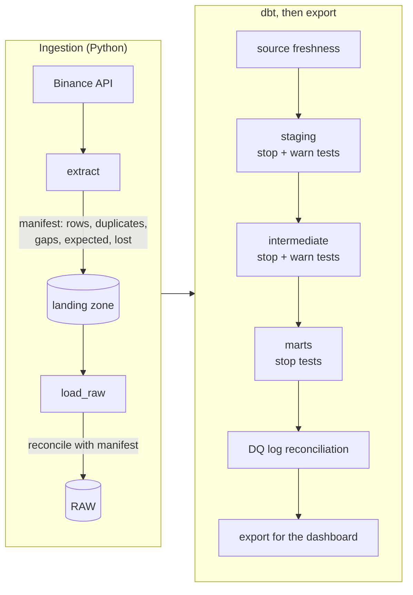

# Data quality report

> Written on the Snowflake original ([crypto-market-dwh](https://github.com/avbakanin/crypto-market-dwh)).
> The port keeps the same tests and DQ layer and builds `PASS=193 WARN=2` on the same input (source note 117);
> mentions of Snowflake roles, stages and `COPY` describe the original only.

What the pipeline checks, how it reacts, and what the checks found in real Binance data.
State as of 2026-11-24 (pipeline run of 18:07 UTC).

## Summary

| | |
|---|---|
| Data tests | **164**: 151 stop (`error`), 13 warn |
| dbt unit tests | **13** (model logic on fixtures) |
| Source freshness checks | **6** (one per RAW table) |
| Load reconciliation | every batch, every dataset: rows and duplicates per symbol against the extract's manifest |
| DQ log | `DQ.DBT_NODE_RESULTS`, since 2026-11-21: 131 dbt invocations, 4 851 rows |
| Latest build | `PASS=193 WARN=2 TOTAL=195`, reconciliation `PASS=3` |
| Open findings | 2 warn checks, both explained by the source: 4 missing funding settlements, 24 hours of anomalous volume |

Every check was broken on purpose before it was trusted (mutation testing): a test is kept
only after a deliberate bug in the code or the data makes it fail, with the expected number
of rows.

## Where the checks sit

| Layer | Check | Reaction |
|---|---|---|
| Extract | duplicates, gaps, rows against the expected count, history lost past the API's window | written to the batch manifest; a warning in the task log, then caught again as a grid gap by a warn test |
| Load | rows and duplicate keys per symbol in RAW = manifest; files on disk = manifest before any SQL | dataset stops at the first batch that does not reconcile; task fails, alert |
| RAW | freshness of the newest data point (warn 2 h, error 26 h; funding warn 9 h) | error stops the run before `dbt build` |
| Staging | key uniqueness, NULLs, OHLC, epoch round-trip, interval values, share and ratio bounds | **stop**: the build fails, the marts keep the last good state, alert |
| Staging, intermediate | hourly grid, funding settlements, funding mode vs the contract's rate, revised history, spot vs futures price, volume anomaly, rows per day | **warn**: findings stored in a table, a digest alert when a count grows |
| Marts | keys, relationships to `dim_symbol`, 49 rows per event window, control pool completeness, signal rules | **stop** |
| After the build | the DQ log matches every findings table | stop |

### Stop or warn: the rule

- **Stop** what breaks a model or a reader's conclusion: a duplicate key, a NULL price, a
  low above the high, a candle that does not end one hour minus 1 ms after it opens, a
  contract missing from the mapping, a long/short ratio that does not match its shares.
- **Warn** on properties of the source that will stay true: Binance skipped a funding
  settlement on 2026-06-24 and always will have. A stop there would halt every build
  forever, or push someone to "fix" history by interpolation, which is worse.

## What the checks found in real APIs

Each finding is written up with the evidence in [source notes](source_notes.md); the number
links the note.

| Finding | How it showed | Handling |
|---|---|---|
| Binance skipped the 2026-06-24 04:00 funding settlement for 20 of 21 contracts on a 4 h interval ([35](source_notes.md#api-observations-binance-usd-m-futures)) | first full-year extract: `rows=2189, expected=2190` for ENA, PUMP, TAO, ASTER | warn `dq_funding_missing_settlements`: the 4 rows of every build; flagged in staging, not interpolated |
| Hourly volume has a heavy tail ([52](source_notes.md#api-behaviour-observations)) | a z-score of raw volume > 5 in 1 774 hours of the year | the anomaly check uses `ln(volume)`: 24 hours, a list worth reading |
| Funding equals the interest rate most of the time, and BNBUSDT's rate is 0 ([39](source_notes.md#api-observations-binance-usd-m-futures), [41](source_notes.md#api-observations-binance-usd-m-futures)) | a "repeated value" check would fire on healthy data; a check with the FAQ's 0.01 % flagged BNBUSDT | the modal rate is compared with each contract's own rate from `premiumIndex` |
| `fundingTime` lands 0–26 ms after the hour ([33](source_notes.md#api-observations-binance-usd-m-futures)) | exact-time keys would never match the hourly grid | the key is the hour, in extract, loader and staging alike; offset > 1 s is a warn |
| The funding interval differs per contract and changes, with no history served ([34](source_notes.md#api-observations-binance-usd-m-futures)) | GTCUSDT moved from 8 h to 4 h | interval derived from neighbouring settlements; `expected` is an estimate, a mismatch is a warning |
| Open interest and long/short keep only ~30 days; older requests are HTTP 400 ([36](source_notes.md#api-observations-binance-usd-m-futures), [81](source_notes.md#api-observations-binance-usd-m-futures)) | history missed by more than a month is gone | `lost` in the manifest; the pipeline runs every 3 h; RAW is the only copy |
| Open interest returns the **last** `limit` points of a range, klines and funding the first ([37](source_notes.md#api-observations-binance-usd-m-futures)) | paging "like klines" would silently drop 220 of 720 points | windows no wider than `limit`, with an explicit `endTime` |
| Long/short shares are rounded to 4 decimals, the ratio is not ([91](source_notes.md#api-observations-binance-usd-m-futures)) | a fixed tolerance flagged 963 of 16 560 healthy rows | the bound the rounding allows: 0 of 48 024 rows |
| Spot symbol ≠ futures symbol: `PEPEUSDT` ↔ `1000PEPEUSDT` ([31](source_notes.md#api-observations-binance-usd-m-futures)) | without the multiplier the spot/futures check flagged all 1 095 PEPE settlements | multiplier in `config/perpetuals.csv`; the check compares price per coin |
| A year of hourly candles is 8 759, not 8 760; the newest candle is still open ([13](source_notes.md#api-behaviour-observations), [2](source_notes.md#data-quality-observations)) | naive counts raise false completeness alarms | one as-of time per run; only candles with `close_time < now` are kept |
| Closed candles do not change ([27](source_notes.md#api-behaviour-observations)) | 1 104 candles compared with the API, the overlap of every batch identical | incremental by high-water mark; `_is_revised` warn as a detector |
| A +20 % hour almost never happens to liquid coins ([51](source_notes.md#api-behaviour-observations)) | once in a year (p99.9 of hourly returns is +5.35 %) | the pump threshold follows the data: 5 % |
| Tokenized stocks trade on the spot market under crypto-looking symbols ([9](source_notes.md#symbol-selection-whitelist-observations)) | filtered today only by the 365-day history rule | known gap, pinned by a strict `xfail` test |

Platform findings that shaped the controls rather than the data:

- **COPY reloads a changed file under the same name, PUT keeps the old file and says
  `SKIPPED`** ([21, 22](source_notes.md#platform-observations-snowflake)) → batches are
  immutable: a new directory per run, the manifest written last, never overwritten.
- **The default dbt selector silently switched `dbt source freshness` off** ("Nothing to
  do", exit 0) ([76](source_notes.md#tooling-observations-dbt)) → found by reading the log
  of a green task; the command now selects the sources and a DAG test pins it.
- **Every role of a user is active by default** (`DEFAULT_SECONDARY_ROLES = ALL`), and the
  trial granted a role to `PUBLIC` ([15, 19](source_notes.md#platform-observations-snowflake))
  → service users with one role each; a smoke check fails on any extra role.

## Ingestion controls

- **Manifest written last.** A batch without `_manifest.json` is invisible: a crashed
  extract never feeds half a batch to the loader.
- **Expected count.** `rows − duplicates ≠ expected` catches a missing last candle, which
  has no neighbour on one side and so never shows as a gap.
- **Two idempotency barriers.** The loader skips a batch already in RAW (its own check on
  data) and COPY skips files it loaded before (the platform's). A third run of the same
  batch adds zero rows.
- **Source-to-target reconciliation.** Per symbol, rows and duplicate keys in RAW must
  equal the manifest; a mismatch stops that dataset and calls a human.
- **RAW is an append-only journal.** Every version of a record is kept with its lineage
  (`_batch_id`, `_source_file`, file row, file MD5). Deduplication happens in staging, by
  the newest batch, so a revised record can be detected and a bad load deleted precisely.

## The DQ log

Modelled on ODI's error tables (`E$`, replaced each run) plus its check journal
(accumulates):

| Object | What it holds |
|---|---|
| `DQ.dq_*` tables (13) | rows found by each warn test, rebuilt each run, readable names (`dq_volume_anomaly`) |
| `DQ` views (stop tests) | the query of each stop test: empty while it passes, the offending rows the moment it fails, no warehouse cost |
| `DQ.DBT_NODE_RESULTS` | one row per node per dbt invocation, written by an `on-run-end` hook with bind variables: status, failures, severity, findings relation, timings |
| `DQ.DQ_CHECK_RESULTS` (view) | checks only, normalized severity, the latest result of each check |
| `DQ.DQ_DATA_COVERAGE` (view) | first and last data point of each dataset, the horizon shown on the dashboard |

Two tests check the log itself:

- **Policy test** (compiled from the dbt graph, reads no table): every warn test stores its
  findings in a table, every other test in a table or a view. A new warn test without
  `store_failures_as` fails it.
- **Reconciliation** (`dbt test --select tag:dq_log`, after the build): each findings table
  exists, its `row_count` in `INFORMATION_SCHEMA.TABLES` equals the failures the log
  recorded, and the log row is not older than the table. It caught a hook that stopped
  logging tests, which plain counts would have missed (the old log rows still matched)
  ([59](source_notes.md#platform-observations-snowflake)).

Cost: storing the failures of every test took a build from 28 s to 51 s, inside the same
warehouse wake-up ([58](source_notes.md#platform-observations-snowflake)).

Readers: Telegram alerts quote the failing check and `select * from` its findings relation,
read from dbt's artifacts without connecting to Snowflake; warnings come as a digest only
when a count grows; an outside watchdog (healthchecks.io) alerts when the pipeline goes
silent. The dashboard's **Data quality** tab shows coverage, the checks that need a look and
the warn history over full builds.

## Testing the tests

- **Unit tests for logic the data never exercises.** A mutant "the oldest batch wins the
  dedup" passed all 35 staging data tests of the time: on live data every version of a candle is
  identical, so any choice gives the same table. Only a unit test with two different
  versions, the older one loaded later, caught it.
- **Mutation counts, not just pass/fail.** Warn tests were broken through `config: where`
  and the number of rows checked: a dropped symbol gives exactly 365 missing days, a
  contract rate replaced by the FAQ constant flags exactly BNBUSDT.
- **A mutant must reach the test.** A data filter that touched a unit-test fixture made the
  unit test fail first and the model skip, so the data test never ran; mutants are chosen
  to bypass fixtures.

## The week 4 criterion, live

"Broken data stops the pipeline and sends an alert", shown with data, not with a code
change ([83](source_notes.md#tooling-observations-dbt)), on 2026-11-22:

1. **16:05 UTC.** Under the loader's role, one RAW row for BTCUSDT 12:00 with `high` and
   `low` swapped, in a batch one second newer than the real one: a source resending a
   candle with a bug.
2. **16:06.** Manual run: extracts and load green; staging took the newest version, the
   OHLC stop test failed (1 row, `_version_count` 2), the revised-history warn found it too.
   `dbt_build` failed, 34 nodes below were skipped, the marts kept the previous state,
   the reconciliation did not run, no heartbeat went out.
3. **16:07.** One Telegram message: the failed check and the query of its findings view.
4. **Clean-up.** `DELETE … WHERE _source_file = 'demo/injected_bad_candle.json'` removed
   exactly one row; the view still showed it until staging was rebuilt.
5. **18:07.** Next scheduled run green: `PASS=117 WARN=2`, reconciliation `PASS=3`.

A warning absent from a failure alert means "not checked", not "fixed": a failed stop test
skips everything below it ([82](source_notes.md#tooling-observations-dbt)).

## Known gaps

- **Tokenized stocks** are excluded only by the history rule (strict `xfail`).
- **Snapshots without history:** the whitelist, contract multipliers and interest rates are
  snapshots of 2026-11; a changed rate would be compared with old settlements (that is why
  the funding mode check is a warn).
- **PUT cannot tell a changed file from the same file** under one name; immutability of
  batches is the only defence, and reconciliation catches a changed row count only.
- **Removed tests stay "latest" in the log** forever; partial builds of mutation tests are
  in the log too, so the warn history counts full builds only
  ([102](source_notes.md#tooling-observations-dbt)).
- **Long/short and open interest** cover about a month: history grows only forward, while
  the pipeline runs.
